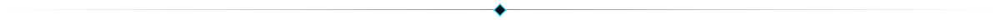

<p align="center">
  
</p>

<p align="center">
  <a href="#overview">Overview</a> ·
  <a href="#architecture">Architecture</a> ·
  <a href="#how-it-works">How it works</a> ·
  <a href="#implementation-details">Implementation</a> ·
  <a href="#results">Results</a> ·
  <a href="#running-the-project">Run</a>
</p>

## Overview

A fully connected neural network that classifies MNIST handwritten digits, written in NumPy with no machine learning framework. Forward propagation, the softmax and cross-entropy gradients, backpropagation, and gradient descent are all derived by hand and implemented as vectorized matrix operations.

The goal was to understand how a network learns, not to beat modern architectures. Most of the time went into the derivations, in particular categorical cross-entropy combined with softmax, and the backward pass. That took roughly a day.

| | |
|---|---|
| **Language** | Python |
| **Libraries** | NumPy, Pandas |
| **Environment** | Jupyter Notebook / Google Colab |
| **Dataset** | MNIST handwritten digits |
| **Frameworks** | None (no PyTorch, TensorFlow, or Keras) |



## From Scratch series

This is one entry in a personal series where I implement machine learning algorithms and neural network architectures myself, to understand the mathematics and mechanics instead of calling a high-level library.

Each entry follows the same conventions:

- Built from first principles, with the derivation written down before the code.
- Diagrams and layout share one visual identity: dark background, cyan and violet accents, monospace labels.
- Titled with a `FROM SCRATCH / NNN` label.

<details>
<summary>Series palette</summary>

| Role | Hex |
|---|---|
| Background | `#070a14` → `#0e1124` |
| Accent A (data, inputs) | `#22d3ee` |
| Accent B (outputs, gradients) | `#8b5cf6` |
| Text / muted | `#e8ecff` / `#7080a6` |

</details>


## Architecture

<p align="center">
  
</p>

**784 → 10 → 10**

| Layer | Neurons | Activation | Parameters |
|---|---|---|---|
| Input | 784 | Normalized pixel values | — |
| Hidden | 10 | ReLU | `W1` (10, 784) + `b1` (10, 1) = 7,850 |
| Output | 10 | Softmax | `W2` (10, 10) + `b2` (10, 1) = 110 |

Total: 7,960 trainable parameters. Each 28 × 28 image is flattened to 784 features, and the ten outputs correspond to digits 0 through 9.


## How it works

### Forward propagation

```python
Z1 = W1 @ X + b1
A1 = relu(Z1)

Z2 = W2 @ A1 + b2
A2 = softmax(Z2)
```

The hidden layer applies ReLU. The output layer applies softmax, which turns the ten scores into a probability distribution over the digits.

Softmax is computed in its numerically stable form, subtracting the maximum logit before exponentiation:

$$
\hat{y}_k = \frac{e^{\,z_k - \max_j z_j}}{\sum_j e^{\,z_j - \max_j z_j}}
$$

### Loss

Labels are one-hot encoded. The loss is categorical cross-entropy averaged over the `m` examples:

$$
\mathcal{L} = -\frac{1}{m}\sum_{i=1}^{m}\sum_{k=0}^{9} y_k^{(i)} \log \hat{y}_k^{(i)}
$$

### Backpropagation

Combining softmax with cross-entropy collapses the output-layer gradient to a difference between prediction and label. Because the one-hot labels sum to 1, the derivative with respect to each logit is `ŷₖ − yₖ`:

$$
dZ^{[2]} = A^{[2]} - Y
$$

The gradient is then pushed back through the weights and gated by the ReLU derivative:

$$
dZ^{[1]} = \left(W^{[2]\top} dZ^{[2]}\right) \odot \mathbb{1}\left[Z^{[1]} > 0\right]
$$

Parameter gradients average over the batch:

$$
dW^{[l]} = \frac{1}{m}\, dZ^{[l]} A^{[l-1]\top}, \qquad
db^{[l]} = \frac{1}{m}\sum_{i=1}^{m} dZ^{[l](i)}
$$

with `A[0] = X`. In code:

```python
dZ2 = A2 - one_hot_y
dZ1 = deriv_relu(Z1) * (W2.T @ dZ2)

dW2 = (dZ2 @ A1.T) / m
db2 = np.sum(dZ2, axis=1, keepdims=True) / m

dW1 = (dZ1 @ X.T) / m
db1 = np.sum(dZ1, axis=1, keepdims=True) / m
```

### Gradient descent

Each epoch uses the full training set and updates every parameter with the same rule:

$$
\theta \leftarrow \theta - \alpha \, d\theta, \qquad \alpha = 0.1
$$


## Implementation details

**Weight initialization.** Weights use He-scaled uniform initialization: uniform random values in [0, 1) multiplied by the He factor `sqrt(2 / fan_in)`. This is not standard He normal initialization, which would draw from a normal distribution with `np.random.randn`. Biases start at zero.

```python
W1 = np.random.rand(10, 784) * np.sqrt(2 / 784)
W2 = np.random.rand(10, 10) * np.sqrt(2 / 10)

b1 = np.zeros((10, 1))
b2 = np.zeros((10, 1))
```

**Normalization.** Pixel values are scaled from 0–255 to 0–1.

**Vectorization.** Images are stored as matrix columns, so the input has shape `(784, m)`. Every layer is a single matrix multiplication over the whole batch, and each neuron has one bias that broadcasts across examples.

**Data split.** The data is loaded with Pandas, shuffled, and divided into:

- 1,000 examples for validation
- 1,000 examples for testing
- all remaining examples for training

The validation set is used to monitor generalization and never contributes to parameter updates. The test set is reserved for final evaluation.

**Training configuration.** 500 epochs, learning rate 0.1, full-batch gradient descent. Training and validation accuracy are printed every 50 epochs.


## Results

<p align="center">
  
</p>

| Split | Accuracy |
|---|---|
| Training | ~90% |
| Validation | ~85% |
| Test | ~87% |

These are approximate figures from my own runs, not verified benchmarks. The notebook includes a test-accuracy cell, but a final test result has not been recorded yet. The result is a working implementation of a small network, not a competitive MNIST score.


## Running the project

**Dependencies**

```bash
pip install numpy pandas jupyter
```

**Dataset.** The notebook reads:

```
/content/sample_data/mnist_train_small.csv
```

This path exists in Google Colab's default runtime. To run locally, point the path at your own copy of the CSV, in the same format, in the data-loading cell.

**Execution.** Open the notebook in Colab or Jupyter and run the cells in order. Training runs for 500 epochs and prints training and validation accuracy every 50.

## Project structure

```
.
├── README.md
├── assets/
│   ├── hero.svg
│   ├── architecture.svg
│   ├── metrics.svg
│   └── divider.svg
└── mnist_nn_from_scratch.ipynb
```


## Lessons learned

- **Softmax plus cross-entropy simplifies to `A2 − Y`.** Deriving it by hand explains why frameworks fuse the two operations.
- **Shape bookkeeping is the main source of bugs.** Storing examples as columns, `(features, m)`, makes each gradient a single matmul, and checking shapes at every step catches most mistakes early.
- **Subtract the max logit in softmax.** Without it, large logits overflow in the exponential.
- **Initialization matters even in a small network.** `np.random.rand` gives only positive weights, so the initial distribution is not zero-centered. It trains here, but He normal is the standard choice and a natural comparison.
- **The ReLU derivative is just a mask.** It selects which hidden units pass gradient back, which made the backward pass easier to reason about than I expected.
- **Monitoring on a held-out set shows the gap.** The roughly five-point difference between training and validation accuracy is visible only because validation data never touches the updates.
